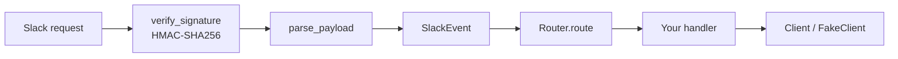

<p align="center">
  
</p>

<h1 align="center">Slack Bot Template</h1>

<p align="center">
  <strong>A transport-agnostic Slack bot framework — slash-command & event parsing, handler routing, and real request-signature verification.</strong><br>
  Parse a payload, route it to a handler, verify the signature — all offline, no <code>slack_sdk</code>, no tokens.
</p>

<p align="center">
  <em>Built and maintained by <a href="https://viprasol.com">Viprasol Tech</a> — Fintech Experts. Full-Stack Builders.</em>
</p>

<p align="center">
  <a href="https://github.com/Viprasol-Tech/slack-bot-template/actions/workflows/ci.yml"></a>
  <a href="LICENSE"></a>
  
  <a href="https://t.me/viprasol_help"></a>
  <a href="https://github.com/Viprasol-Tech/slack-bot-template/stargazers"></a>
</p>

---

> ### Offline & pluggable by design
> The networking transport is a `Client` **protocol** with a built-in `FakeClient`, so the demo and the entire test suite run with **no network, no tokens, and no `slack_sdk` dependency**. Swap in your own `requests`/`httpx` call behind the protocol when you go live. The real logic — payload parsing, handler routing, and HMAC-SHA256 signature verification — is genuine and fully tested.

---

## Features

- **Unified event parsing** — `parse_payload` normalises slash commands *and* Events API callbacks into one typed `SlackEvent`.
- **Handler routing** — register slash commands by name and events by kind; `route(payload)` returns the Slack response dict.
- **Real signature verification** — HMAC-SHA256 over `v0:{timestamp}:{body}`, constant-time compare, plus replay protection. Tested against an independently computed HMAC.
- **Pluggable transport** — a `Client` protocol with a deterministic `FakeClient` that records every message.
- **URL-verification handshake** — the Events API `challenge` is echoed automatically.
- **CLI** — `slack-bot-template demo` signs, verifies, and routes a slash command offline.
- **Modern tooling** — ruff, mypy (strict), pytest, GitHub Actions CI.

## Quickstart

```bash
git clone https://github.com/Viprasol-Tech/slack-bot-template.git
cd slack-bot-template
python -m pip install -e ".[dev]"

# Sign, verify, and route a slash command — fully offline:
slack-bot-template demo
slack-bot-template demo --command /weather --text "San Francisco"
```

## Build your own bot

```python
from typing import Any

from slack_bot_template import EventKind, FakeClient, Router, SlackEvent
from slack_bot_template import sign_request, verify_signature

client = FakeClient()
router = Router()


@router.command("/deploy")
def deploy(event: SlackEvent) -> dict[str, Any]:
    client.post_message(event.channel or "C0", f"Deploying {event.text}...")
    return {"response_type": "ephemeral", "text": f"Deploy queued: {event.text}"}


@router.event(EventKind.APP_MENTION)
def greet(event: SlackEvent) -> dict[str, Any]:
    return {"text": f"Hi <@{event.user}>!"}


# Verify the inbound request before trusting it:
signature = sign_request("signing-secret", "1700000000", body="...")
assert verify_signature("signing-secret", "1700000000", "...", signature, max_skew_seconds=0)

# Route a parsed payload to its handler:
response = router.route({"command": "/deploy", "text": "prod", "channel_id": "C1"})
```

## Architecture



## Roadmap

- [x] Slash-command & Events API parsing into a typed `SlackEvent`
- [x] Handler routing with slash/event/default dispatch
- [x] Real HMAC-SHA256 signature verification with replay protection
- [x] Pluggable `Client` protocol + `FakeClient`
- [ ] Block Kit message builders
- [ ] Interactive components (buttons, modals) & shortcuts
- [ ] Async handler support

## Contributing

PRs welcome — see [CONTRIBUTING.md](CONTRIBUTING.md) and our [Code of Conduct](CODE_OF_CONDUCT.md).

## 📬 Contact — Viprasol Tech Private Limited

- 🌐 Website: [viprasol.com](https://viprasol.com)
- ✉️ Email: [support@viprasol.com](mailto:support@viprasol.com)
- 💬 Telegram: [t.me/viprasol_help](https://t.me/viprasol_help) · 📱 WhatsApp: +91 96336 52112
- 🐙 GitHub: [@Viprasol-Tech](https://github.com/Viprasol-Tech) · 💼 [LinkedIn](https://www.linkedin.com/in/viprasol/) · 𝕏 [@viprasol](https://twitter.com/viprasol)

> *Viprasol Tech — fintech software, algorithmic trading systems, MT4/MT5 bots, AI voice agents, and B2B SaaS. Need a custom build? [Get in touch](mailto:support@viprasol.com).*

## License

[MIT](LICENSE) (c) 2025 Viprasol Tech Private Limited
